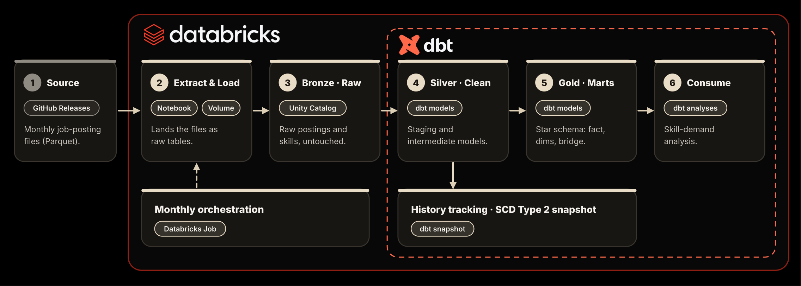
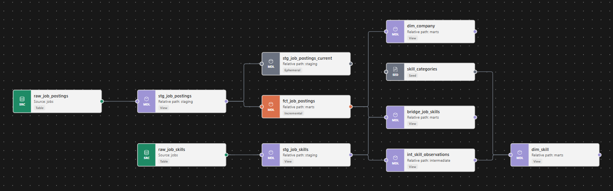

# Job Postings Analytics Pipeline — dbt + Databricks

[](https://ahlammahmedd.github.io/dbt-databricks-pipeline/)




An ELT pipeline on **Databricks** that turns **843,097 raw job-posting scrapes** (Data Engineer, Data Analyst and Data Scientist roles, Jul 2025 – Jun 2026) into a tested **star schema**, with **SCD Type 2 history** tracking separate **dev and prod** environments, and a scheduled monthly run.

- Lands raw Parquet files into a Unity Catalog Volume and bronze tables
- Cleans and models the data with dbt through **staging → intermediate → marts** (medallion architecture)
- Serves a star schema (fact + dimensions + bridge) that answers questions such as *which skills are most in demand for each role?*

| What I Built | How I Implemented It | Where to Look |
| --- | --- | --- |
| **Ingestion (EL)** | Databricks notebook downloads Parquet into a Volume, then lands bronze tables | [`scripts/load_raw.py`](scripts/load_raw.py) |
| **Staging** | Cleaning, salary parsing, benefit flags, bad-row filtering | [`analytics/models/staging/`](analytics/models/staging/) |
| **Intermediate** | Re-grains 3.3M (job, skill) rows into one row per skill | [`analytics/models/intermediate/`](analytics/models/intermediate/) |
| **Star schema** | `fct_job_postings` + `dim_company` + `dim_skill` + `bridge_job_skills` | [`analytics/models/marts/`](analytics/models/marts/) |
| **SCD2 snapshot** | `check` strategy over 13 watched columns, plus a one-query backfill | [`analytics/snapshots/`](analytics/snapshots/) + [`scripts/`](scripts/) |
| **Incremental fact** | `merge` on `job_id`, only new scrape days load | [`fct_job_postings.sql`](analytics/models/marts/fct_job_postings.sql) |
| **Macros** | A custom salary parser and an overridden built-in | [`analytics/macros/`](analytics/macros/) |
| **Tests** | Generic, custom generic and singular tests | [`analytics/tests/`](analytics/tests/) + the properties YAMLs |
| **Environments** | `dev` and `prod` catalogs with the same schemas (staging, intermediate, marts, seeds, snapshots) | Unity Catalog: `dev` + `prod` |
| **Orchestration** | Scheduled Databricks Job that runs the pipeline monthly | Databricks → Jobs & Pipelines |
| **Analyses** | Skill-demand questions kept next to the models that answer them | [`analytics/analyses/`](analytics/analyses/) |

---

## 🏗️ Architecture

Data moves through six stages. Databricks owns the platform (storage, compute, governance, scheduling) and dbt owns every transformation after the raw layer.

| Stage | Layer | What happens | Tooling |
| --- | --- | --- | --- |
| 1 | **Source** | Monthly job-posting extracts published as Parquet files | GitHub Releases |
| 2 | **Extract & Load** | Files are downloaded into a Volume and landed as raw tables (idempotent, safe to re-run) | Databricks notebook, Volume |
| 3 | **Bronze** | `raw.jobs.raw_job_postings` (843,097 rows) and `raw.jobs.raw_job_skills` (3,304,574 rows), untouched | Unity Catalog |
| 4 | **Silver** | Staging and intermediate models: clean, parse, enrich, re-grain | dbt |
| 5 | **Gold** | Star schema marts built for analysis | dbt |
| 6 | **Consume** | Parameterised analyses on top of the marts | dbt analyses |

---

## ⚙️ The dbt Pipeline

Raw scrapes flow through the medallion layers — raw → staging → intermediate → the star-schema marts. The lineage graph below shows the sources, models and seed. The `job_postings_snapshot` (SCD2) reads from the ephemeral `stg_job_postings_current` model, which is why that node has no downstream edge here:



And the dbt features doing the work:

| dbt Feature | How I Used It |
| --- | --- |
| Declared sources | `source('jobs', 'raw_job_postings')` — no hardcoded table paths |
| Jinja beyond templating | Benefit flags (`has_health_insurance`, …) generated by a loop; adding a keyword adds a column |
| Custom macro | `parse_salary()` — one expression written once and reused four times |
| Installed package | `dbt_utils.get_column_values()` — the role loop reads the data instead of a typed list |
| Overriding a built-in | `generate_schema_name` — models land in the schema named by their folder |
| Seeds | The skill taxonomy (1,422 skills) as version-controlled reference data |
| Ephemeral model | `stg_job_postings_current` picks the latest scrape per job as the snapshot input |
| Test-driven cleaning | Staging drops 151,147 scraper-flagged error rows and 6,255 id-less postings, documented in the YAML |
| Singular + custom tests | `assert_salaries_sane` flags USD yearly salaries of 1M or more; `non_negative` guards salary columns |
| SCD2 snapshot | `check` strategy over 13 content columns, dated by `searched_at` |
| Incremental model | `merge` on `job_id`, filtered by a `search_date` high-water mark via `is_incremental()` |
| Environments | `dev` and `prod` as separate catalogs, so development never touches production tables |
| Persisted docs | `persist_docs` pushes model and column descriptions into Unity Catalog |

`dbt build` compiles SQL, materialises models, runs seeds and tests, and fails the run if any test fails.

---

## 🚀 Production

**Databricks** owns the runtime: storage, compute, governance and the schedule, all on one platform.

- **Dev and prod as catalogs:** `dev` and `prod` each hold the same schemas (`staging`, `intermediate`, `marts`, `seeds`, `snapshots`), next to a shared `raw` catalog that is loaded once and read by both
- **Scheduled Databricks Job:** runs the pipeline monthly, matching the cadence of the monthly source files: the ingest notebook ([`scripts/load_raw.py`](scripts/load_raw.py)) first, then dbt
- **Same command everywhere:** `dbt build` runs models, seeds and tests, and fails the run if any test fails

---

## 📸 Snapshots

The marts keep each job's **latest** scrape. The snapshot keeps **every version**: whenever one of 13 watched columns changes (title, company, location, schedule type, remote flag, salary range, salary period, currency, or any of the four benefit flags), a new row is written with `dbt_valid_from` and `dbt_valid_to`.

- Input: `stg_job_postings_current`, the latest scrape per job up to an `as_of` date
- Backfill: [`scripts/backfill_job_postings_snapshot.sql`](scripts/backfill_job_postings_snapshot.sql) rebuilds a year of daily history in a single query, and `dbt snapshot` takes over seamlessly afterwards

---

## 📖 Docs

Structure, tests and column descriptions are written in the YAML files, and the generated dbt docs site is published on GitHub Pages:

**→ [ahlammahmedd.github.io/dbt-databricks-pipeline](https://ahlammahmedd.github.io/dbt-databricks-pipeline/)**

The site (its source lives in [`docs/`](docs/)) shows:

- The full **lineage graph** (raw → staging → intermediate → marts → snapshot)
- **Model and column descriptions**
- Which columns carry **tests**

The same descriptions live in the warehouse, so Catalog Explorer shows them next to the data.

---

## 💻 Run it yourself

**Prerequisites:** a Databricks workspace (the [Free Edition](https://www.databricks.com/learn/free-edition) works) and [uv](https://docs.astral.sh/uv/).

1. **Load the raw data.** Import [`scripts/load_raw.py`](scripts/load_raw.py) as a Databricks notebook and run it. It creates the `raw` catalog, downloads the Parquet files into a Volume, and lands the two bronze tables.
2. **Set up the environment and run dbt:**

```bash
uv sync && source .venv/bin/activate     # Python environment
cd analytics
dbt deps                                 # installs dbt_utils (dbt_packages/ isn't committed)
dbt debug                                # checks the Databricks connection (profile: databricks)
dbt build                                # models + seed + tests
dbt snapshot                             # one SCD2 pass
```

3. **Backfill snapshot history (optional).** Paste [`scripts/backfill_job_postings_snapshot.sql`](scripts/backfill_job_postings_snapshot.sql) into the Databricks SQL editor and run it once.

Your `profiles.yml` holds your own workspace host, warehouse path and credentials, so it is not part of this repo.

---

## 📁 Project layout

```text
.
├── analytics/
│   ├── dbt_project.yml
│   ├── packages.yml                  # dbt_utils
│   ├── models/
│   │   ├── sources.yml               # raw.jobs.*
│   │   ├── staging/                  # clean + type + enrich
│   │   ├── intermediate/             # per-skill demand counts
│   │   └── marts/                    # the star schema
│   ├── snapshots/                    # SCD2: job_postings_snapshot
│   ├── seeds/                        # skill_categories.csv
│   ├── macros/                       # parse_salary, slugify, generate_schema_name
│   ├── tests/                        # singular + custom generic
│   └── analyses/                     # in_demand_skills, jinja_example
├── scripts/                          # load_raw.py + snapshot backfill
├── docs/                             # generated dbt docs site
└── img/                              # README assets
```

---